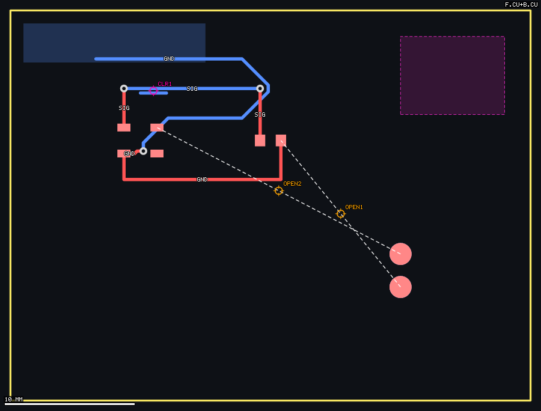

# Data format for programs and AI tools

`fastroute inspect` and the image commands write JSON so that a program (or an AI model) does
not have to read nets, coordinates and layers off a picture:

| File | Written by | Contents |
|---|---|---|
| `inspect.json` | `fastroute inspect` | the board: outline, layers, components, pads, nets, routing state, unrouted connections and violations with coordinates, design rules, status of every check |
| `manifest.json` | `fastroute render --manifest`, `fastroute ai-pack` | the images: for each PNG its region, layers, pixel size, scale, the millimetre↔pixel transform, and which components, nets and issues are in it |

Both are UTF-8 JSON with a machine-checkable schema ([docs/schema/](schema/)) and complete
examples ([docs/examples/](examples/), generated by the tool and checked by the tests).

```sh
fastroute inspect -i board.dsn -s routed.ses -o inspect.json
fastroute render  -i board.dsn -s routed.ses -o board.png --manifest manifest.json
```



## Rules every file follows

* **Units and axes.** Lengths are millimetres, angles degrees. x is to the right, **y points
  down** (KiCad's convention, the same as `--report`). The origin is that of the design (for a
  KiCad export: the board origin); for a design that does not come from KiCad the y values are
  the DSN's y negated. `coordinate_system` in each file says so in words.
* **Nothing is invented.** A number is either measured from the board or `null`/absent with a
  status. "Not run" is never written as "passed" (see *DRC* below); a failed run is a document
  with `"status": "error"` and an explanation, not only a line on stderr. An `ok` document always
  has all its lists, empty if there is nothing in them (`"unrouted": []` means none; a missing
  list never does).
* **Versions.** `format` names the document type and `format_version` is `MAJOR.MINOR`.
  Minor versions only **add** properties; the meaning and type of existing ones do not change.
  A reader of `1.x` must accept any `1.y` and ignore properties it does not know. A new `MAJOR`
  may change anything; `fastroute` itself refuses an `inspect.json` of another major version
  with a message instead of misreading it.
* **Ids.** Problems get ids that cannot be mistaken for component references: `OPEN<n>`
  (unrouted connection), `CLR<n>` (clearance violation found by fastroute), `DRC<n>` (reported
  by KiCad's DRC). Ids are stable for the same design and session.
* **Files.** Hashes are SHA-256 of the file bytes. Paths inside a manifest are relative to the
  manifest where possible.

## `inspect.json`

```jsonc
{
  "format": "fastroute-inspect", "format_version": "1.0", "fastroute_version": "0.1.14",
  "generated_by": "fastroute inspect",
  "status": "ok",                         // "ok" | "error" (then only input/session/warnings/errors)
  "input":   { "path": "board.dsn", "bytes": 2567, "sha256": "…" },
  "session": { "path": "routed.ses", "bytes": 2230, "sha256": "…" },       // or null
  "coordinate_system": { "unit": "mm", "x_axis": "right", "y_axis": "down", "origin": "…", … },
  "board":      { … },     "components": [ … ],   "pads": [ … ],   "nets": [ … ],
  "routing":    { … },     "unrouted":   [ … ],   "violations": [ … ],
  "rules":      { … },     "checks":     { … },
  "warnings": [ "…" ], "errors": [ ]
}
```

| Property | Meaning |
|---|---|
| `board.outline_bbox_mm` | `{x, y, width, height}` of the outline; `x,y` is the top-left corner. `null` without an outline |
| `board.outline` | the outline polygons (a hole in the board is its own polygon), `[{x,y},…]` |
| `board.layers[]` | `{index, name, type}`; index 0 is the top layer; `type` is `signal` or `power` |
| `components[]` | `{ref, side, x, y, rotation_deg, bbox_mm, pad_count}`; `bbox_mm` covers the whole package (pads and outline); sorted naturally (`U2` before `U10`) |
| `pads[]` | one per pin: `{component, pin, net, layers[], x, y, shape, bbox_mm}`; `x, y` is the pad's centre **as the router uses it** — the point where connections and `unrouted` endpoints end. For a KiCad custom-shaped pad whose copper is not centred on its anchor this is the centre of the copper, **not KiCad's pad position** (JP1 of KiCad's `pic_programmer` demo: 0.25 mm apart); `bbox_mm` is the copper; `net` is `null` without a net; a through-hole pad lists all its layers; sorted by component, then pin. Pin names are those of the DSN (KiCad's export renames duplicates `HOLE`, `HOLE@1`, and drops mounting holes without copper) |
| `nets[]` | `{name, class, pad_count, status, unrouted_connections, trace_count, trace_length_mm, via_count, has_plane}`; `status` is `complete`, `incomplete` or `not_applicable` (fewer than two pads) |
| `routing` | `status` (`complete` when nothing is unrouted — connectivity only), `unrouted_connections`, `unrouted_in_ignored_classes`, `trace_count`, `trace_length_mm`, `via_count`, `clearance_violations`, `clearance_violations_unfixable` |
| `unrouted[]` | `{id, net, length_mm, ignored_class, from, to}`; `from`/`to` are `{x, y, item}` with `item = {kind, component?, pin?, layers[]}`; the points are the airline ends (pad centres for pins) |
| `violations[]` | `{id, layer, x, y, required_mm, actual_mm, unfixable, first, second}`; `x,y` is the middle of the overlap; see *Fixable* below |
| `rules` | `source` (`dsn`), `file`, `net_classes[]` = `{name, nets[], trace_width_mm[], clearance_mm[], ignored_by_autorouter, min_length_mm, max_length_mm}` with per-layer values `{layer, value_mm}`; `note` says what is not listed |
| `checks` | `connectivity` and `fastroute_clearance` (fastroute's own, always `completed`), and `drc` |

Trace and via numbers count the wiring of the design **and the session**, without the short
bridge stubs that the router adds internally to join trace ends to pad centres.

**Sessions replace.** A session is the complete result of a routing run; it already contains
the pre-routed wiring of the design. With `--session`, the design's own traces and vias
(except `(type fix)` ones) are therefore left out and the session's are used. A warning says
how many.

**Fixable.** `unfixable: true` means neither item can be moved by the router: pads, fixed
keepouts, and wiring that the design marks as fixed. Wiring that comes from a session counts as
movable, as in `route --initial-session`; the `(type protect)` marks of a session are not read
back. So the same board can have a violation that is unfixable without `--session` and fixable
with it.

### `checks.drc`

KiCad's design rule check. `inspect` does not run it; pass a report with
`--drc-report` (made with `kicad-cli pcb drc --format json --units mm`) or use
[`fastroute ai-pack`](CLI.md), which runs `kicad-cli`.

| `status` | Meaning |
|---|---|
| `not_run` | nobody ran or supplied a DRC. **Not** a pass |
| `unavailable` | `kicad-cli` was not found |
| `error` | the tool failed, or its report could not be read (`detail` says why) |
| `timeout` | the tool was stopped after the time limit |
| `failed` | a readable report lists violations or unconnected items; `violations`, `unconnected`, `errors`, `warnings` and `issues[]` (`DRC<n>`, with `x`, `y`, KiCad's `type`, `severity`, `description`, `items[]`) are filled |
| `passed` | a readable report lists none |

`fastroute_clearance` is the router's own clearance check of the loaded wiring; it is useful,
but it is not KiCad's DRC and the two are never mixed in one number.

### Errors

With `status: "error"` the file has `input`/`session` (when readable), `warnings` and
`errors[] = {code, message}` and **no** board data. `code` is `usage`, `input_invalid`, `output`
or `failed` and matches the exit code (2, 3, 4, 1).

## `manifest.json`

```jsonc
{
  "format": "fastroute-manifest", "format_version": "1.0", "fastroute_version": "0.1.14",
  "generated_by": "fastroute render",
  "status": "ok",                               // "ok" | "partial" | "error"
  "input": { … }, "session": { … },
  "coordinate_system": { … },
  "images": [ { … } ],
  "reports": { "inspect": { "file": "inspect.json", "status": "present" }, … },
  "warnings": [ ], "errors": [ ]
}
```

Each entry of `images[]`:

| Property | Meaning |
|---|---|
| `file`, `bytes`, `sha256` | the PNG |
| `purpose` | `overview`, `region`, `region-combined` or `region-layer` |
| `selection` | how the region was chosen: `{type: board \| region \| component \| net \| issues, targets[], padding_mm}` |
| `width_px`, `height_px` | pixel size |
| `region_mm` | the area the image **really** shows: `{x, y, width, height}`, `x,y` = top-left corner |
| `px_per_mm`, `mm_per_px` | scale (square pixels) |
| `transform` | the conversion, see below |
| `layers[]` | the copper layers drawn, top to bottom |
| `annotations[]` | the labels that were switched on: `grid scale layer nets pads refs markers` |
| `airlines` | whether unrouted connections are drawn |
| `contains` | `{components[], nets[], issues[]}` whose geometry reaches into the image (objects cut by the border count) |
| `labels` | `{drawn, skipped_overlap, skipped_small}`: labels never overlap, a label that would is left out |

`reports{}` names the companion files of a pack (`inspect`, `route_report`, `drc_report`,
`rules`) with a `status` (`present`, `not_run`, `unavailable`, `failed`, `timeout`) and the
relative path (`null` when the file does not exist).

### Converting millimetres and pixels

Pixel `(u, v)` has its origin at the top-left **corner** of the image, `u` to the right, `v`
downwards, pixel centres at +0.5. World and pixel axes are not flipped against each other.
`transform` has both directions, each as `{scale, offset}`:

```
u = world_to_pixel_u.scale * x + world_to_pixel_u.offset        (= (x - region.x) * px_per_mm)
v = world_to_pixel_v.scale * y + world_to_pixel_v.offset
x = pixel_to_world_x.scale * u + pixel_to_world_x.offset
y = pixel_to_world_y.scale * v + pixel_to_world_y.offset
```

```python
import json
m = json.load(open("manifest.json"))
img = m["images"][0]
t = img["transform"]
def to_pixel(x, y):
    return (t["world_to_pixel_u"]["scale"] * x + t["world_to_pixel_u"]["offset"],
            t["world_to_pixel_v"]["scale"] * y + t["world_to_pixel_v"]["offset"])

pad = next(p for p in json.load(open("inspect.json"))["pads"] if (p["component"], p["pin"]) == ("U1", "3"))
u, v = to_pixel(pad["x"], pad["y"])          # where that pad is in the picture
```

Because `region_mm` is stored per image, the same board can be drawn at several scales and
regions and every image stays interpretable on its own. `fastroute`'s tests do this round
trip: they read a pad position from `inspect.json`, convert it with the manifest of an image
and check the colour of that pixel.

## Compatibility tests

`crates/fastroute/tests/inspect_cli.rs` and `render_cli.rs` validate real output against the
schemas, check that a `1.9` document with unknown properties is still readable and a `2.0`
one is refused, check that the schema rejects a wrong document, regenerate the example in
`docs/examples/` and compare it with the committed file, and run the pixel round trip above.
