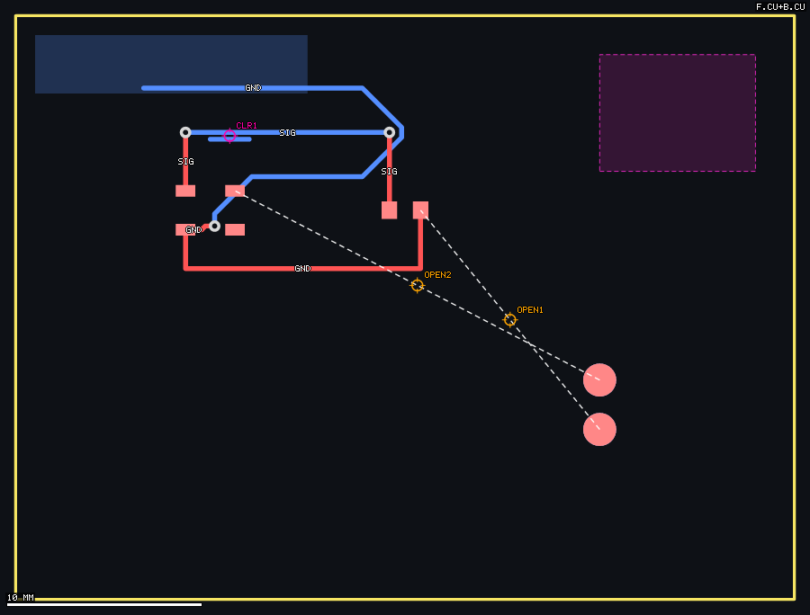
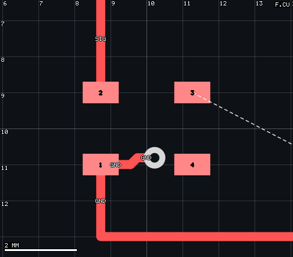

# Analysis packs (`fastroute ai-pack`)

One command writes a local directory that you can hand to an AI model, a colleague or an
archive: pictures of the whole board and of the area you care about (combined and per layer),
the board as data, the design rules, the routing report and the result of KiCad's own design
rule check, all tied together by a manifest. **Nothing is uploaded**; the command only reads its
inputs, writes into the directory you name and runs `kicad-cli` locally if you ask it to.

```sh
# the routed result of a route run, around the problems that are left
fastroute ai-pack -i board.dsn -s routed.ses -o pack/

# a BGA fan-out, with KiCad's DRC on the routed board
fastroute ai-pack -i board.dsn -s routed.ses -o pack-u1/ --around U1 --padding-mm 3 \
    --kicad-pcb routed.kicad_pcb

# a differential pair on its layer
fastroute ai-pack -i board.dsn -s routed.ses -o pack-usb/ --net USB_DP --net USB_DN --layers F.Cu

# check a pack you received
fastroute ai-pack --verify pack/
```

## What is in the directory

| File | Content |
|---|---|
| `overview.png` | the whole board, with component references and numbered issue markers |
| `region-combined.png` | the region of interest, all selected layers overlaid, with grid, net and pad names |
| `region-<layer>.png` | the same rectangle, one copper layer each — only layers that have copper in it |
| `inspect.json` | the board as data ([AI_DATA_FORMAT.md](AI_DATA_FORMAT.md)) |
| `rules.json` | the design rules (net classes with widths and clearances), or the file you gave with `--rules` |
| `route-report.json` | fastroute's `--report` summary of the board, or the report of a route run given with `--report` |
| `drc-report.json` | **KiCad's own JSON, byte for byte** — present only if a real DRC ran or was supplied |
| `manifest.json` | every picture (region, scale, mm↔pixel transform, what is in it), every report and its status; written last |

All pictures of the region show **the same rectangle**, so they can be compared pixel for
pixel; `manifest.json` has the transform of each one. Pictures link to the data by id:
`images[].contains.issues` lists the `OPEN…`/`CLR…`/`DRC…` ids that are in the picture, and
`inspect.json` has the coordinates, nets and items behind each id.




### Which region?

1. what you ask for: `--around REF`, `--region-mm x,y,w,h`, `--net NAME` (repeatable),
   `--from-report FILE [--select …]`, `--select …` (see [RENDERING.md](RENDERING.md));
2. else the area around **all problems** (unrouted connections, clearance violations, DRC
   findings) plus 3 mm;
3. else the whole board.

The region pictures default to 2048 pixels on the longer side, but never more than 150
pixels per mm (a 3 mm region is not blown up). `--size`, `--px-per-mm`, `--overview-size`,
`--layers` and `--annotate` change that.

## KiCad's DRC — and what the pack says when there is none

KiCad's DRC is the authority on whether a board passes; fastroute's own clearance check
(`checks.fastroute_clearance` in `inspect.json`) is a different tool and is never mixed with it.

* `--kicad-pcb routed.kicad_pcb` runs `kicad-cli pcb drc --format json --units mm
  --severity-all` on that board (KiCad 7 or newer; it must be the routed board that matches the
  session — the KiCad plugin writes it). `kicad-cli` is looked up in `--kicad-cli PATH`,
  `$FASTROUTE_KICAD_CLI`, `PATH` and the usual install places. `--drc-timeout SECONDS` (default
  300) stops a hanging run, including the processes it started.
* `--drc-report FILE` uses a report that was made elsewhere.
* `--no-drc` skips it.

Every outcome has its own status, in `manifest.json` (`drc_status`, `reports.drc_report`) and in
`inspect.json` (`checks.drc.status`), and **only a readable report can be `passed`**:

| `drc_status` | When | `drc-report.json` | Pack `status` |
|---|---|---|---|
| `passed` | a report with no violations and no unconnected items | yes | `ok` |
| `failed` | a report that lists some (they become `DRC<n>` markers in the pictures) | yes | `ok` |
| `not_run` | no board and no report given, or `--no-drc` | no | `ok` |
| `unavailable` | `kicad-cli` not found | no | `partial` |
| `timeout` | it did not finish in time and was stopped | no | `partial` |
| `error` | it failed (exit code, signal) or wrote something unreadable | no | `partial` |

Without `kicad-cli` the command **warns and carries on**: it prints a warning, puts the
warning in `manifest.json` and finishes the rest of the pack. `--require-drc` turns the
missing result into exit code 5 (after the pack is written). A DRC report that you pass
and that cannot be read is an input error (exit 3), not a silent "not run".

## Safety

* The inputs (design, session, board, reports) are never modified, and the pack can never be
  written over them: if a pack file would be one of the inputs the command refuses.
* The output directory must not exist or be empty. A pack is never written over another one;
  `--force` replaces the files **with the pack's names** (and old `region-*.png`) in an existing
  directory and nothing else in it; the directory itself is never removed.
* If the input cannot be read, the command exits with code 3 and `manifest.json` in the
  directory says `"status": "error"` with the reason.
* Before it finishes, the command checks its own result with the same check as `--verify`.

`--verify DIR` checks a pack: every file the manifest names exists with the stated size and
SHA-256, the PNGs have the stated dimensions, the JSON files parse, the statuses agree with the
files (a `present` report has its file; `drc_status` in the manifest equals the one in
`inspect.json` and fits the `drc_report` entry; a stray `drc-report.json` that the manifest
does not know is an error), and every issue id in a picture exists in `inspect.json`. It exits
with 0, or 3 and a list of problems.

## Exit codes

0 done (also with a `partial` pack: `status` and the warnings say what is missing), 2 usage,
3 input (unreadable design, session, report, board; failed `--verify`), 4 output (existing
non-empty directory without `--force`, would overwrite an input), 5 with `--require-drc` and no
DRC result, 1 anything else.

## Tests

`crates/fastroute/tests/aipack_cli.rs` generates real packs from `testdata/render_demo.dsn`
with an empty `PATH` and no display, and uses a scripted stand-in for `kicad-cli` for every
outcome: findings, a clean board, missing tool, a hang (killed within the timeout, with its
child processes), a crash, a non-zero exit, garbage output, and no output at all. It checks
that none of the failures is ever `passed`, the overwrite rules, `--verify` on damaged packs
(changed picture, missing files, wrong status, unknown issue id, stray report), error
manifests, `--rules`/`--report` pass-through and reproducible pictures.
